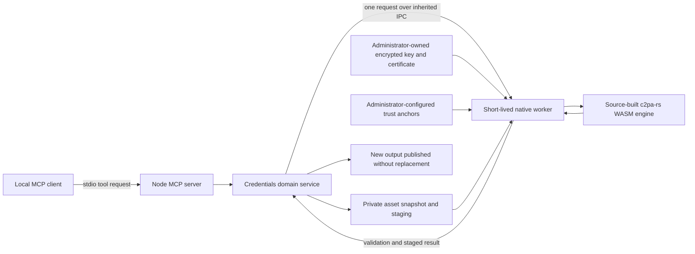

# scrivener-mcp security architecture for C2PA evaluation

Assessment candidate **0.14.0**, prepared 30 October 2026, with source parent
`9b673e010a7e3250b0e7ad9b2b75fdb37346cda7`. Final candidate and source/artifact identities are
recorded in the private evidence packet. The [readiness assessment](readiness.md) records passing
local controls and external schema, platform and administrator-review boundaries. This document
describes the implementation; formal conformance and assurance remain unassessed.

The section numbers follow the C2PA v0.2
[architecture template](https://github.com/c2pa-org/conformance-public/blob/f58b10a3a0e7aea834436728ca18c4ea4ed57fb5/docs/v0.2/C2PA%20Generator%20Product%20Security%20Architecture%20Document%20Template.md).
The controlling
[security requirements](https://github.com/c2pa-org/conformance-public/blob/f58b10a3a0e7aea834436728ca18c4ea4ed57fb5/docs/v0.2/C2PA%20Generator%20Product%20Security%20Requirements.md)
determine applicability; an inapplicable section is identified explicitly.

## 1. Product information

### 1.1 Applicant

WritersLogic, Inc.; United States. Applicant contact: David Condrey, <david@writerslogic.com>. The
local evidence package contains the populated `GPSA-applicant-information.json` address annex;
private address information is excluded from this public repository document. That annex uses the
organization's existing intake receipt and requires applicant review before external submission. No
other product's application identifier is assigned to scrivener-mcp.

### 1.2 Program version

The preparation baseline is Conformance Program **0.2**. Reference documents and the public rubric
are pinned to `c2pa-org/conformance-public` commit `f58b10a3a0e7aea834436728ca18c4ea4ed57fb5`.

### 1.3 Specification version

The assessment target is Content Credentials Specification **2.4**. The installed SDK reports
`c2pa-rs` **0.91.7**, compiled to one local WASM binding for generation and validation. A
hash-checked compatibility patch restricts the SDK’s existing certificate policies to signing and
timestamp purposes; its source and upstream archive are shipped. These versions do not establish
conformance. In the inspected outputs, `claim_generator_info.specVersion` and
`c2pa.actions.v2.allActionsIncluded` are absent. The public 0.2/2.4 rubric rejects these omissions.

### 1.4 Product identity

| Field                     | Value                                           |
| ------------------------- | ----------------------------------------------- |
| CN                        | `scrivener-mcp`                                 |
| O                         | `WritersLogic, Inc.`                            |
| OU                        | Omitted; no department is asserted              |
| C                         | `US`                                            |
| Minimum candidate version | `0.14.0`; not an approved minimum               |
| Product information       | <https://writerslogic.com/scrivener-mcp>        |
| Source                    | <https://github.com/writerslogic/scrivener-mcp> |

The disposable sample certificates identify a synthetic test signer. They are not production
certificates for this distinguished name and are not on the C2PA Trust List.

### 1.5 Purpose and behavior

scrivener-mcp is a local MCP server for reading, editing, analyzing, and exporting Scrivener
projects. Its credentials tools attach signed Content Credentials to an existing local asset and
validate embedded or explicitly supplied detached credentials. They do not require an open Scrivener
project. Signing produces a separate output; it does not overwrite the source manuscript.

The signed record identifies the software, binds the output bytes, and preserves existing embedded
provenance when the operation succeeds. An unsigned source is opened with unknown provenance. The
product does not infer human authorship, originality, capture by a physical sensor, absence of
generative AI, or time spent writing. Optional AI functions elsewhere in the server do not establish
any of those properties. Caller-supplied titles are labels, not verified statements of origin.

### 1.6 Evaluation boundary

The target of evaluation includes the public server's tool dispatch, domain service, native worker,
C2PA SDK and its Rust dependencies, Node/OpenSSL runtime, content-processing dependencies, local
filesystem, and the operating system's process and file-access controls. The credential service does
not use a backend signing service. CA enrollment, the MCP client, and sources that created an input
asset are external entities. Their output is treated as input, not as an authorship guarantee.

The measured reference instance is macOS arm64, Node **24.22.2**. The machine-readable evidence
records the actual OS version, runtime, source hashes and native binary hashes. Existing CI supplies
broader platform compatibility evidence; this packet does not establish an equivalent security
assessment of Windows ACLs or other host configurations. Supported runtime floors are
`^22.23.4 || ^24.22.1 || >=26.12.1`.

The separate paid Draftbridge application, WritersProof, Holographic Memory's asset-signing
application, and their credentials or attestations are not evidence for this product.

### 1.7 Implementation class

**Edge:** claim construction, asset binding, key use, and validation occur on the local host.
Network retrieval of remote manifests and OCSP responses is disabled in the credential SDK
configuration. This is a configuration control, not an OS-enforced network sandbox. Native workers
inherit only selected runtime/platform environment variables; signing configuration is passed over
the inherited local IPC channel. Other server features can use optional services outside this
credential operation.

### 1.8 Assurance target

**AL1 evaluation target only.** No assurance level has been awarded. The capabilities API returns
`conformance.status = "not-assessed"`, `maxAssuranceLevel = null`, and no attestation methods. AL2
is not claimed. Worker separation, an encrypted software key, a signed package, and native SDK usage
are not hardware attestation.

### 1.9 Generation and validation scope

The candidate intake inventory contains **35 MIME choices**, including the `text/xml` alias for
`application/xml`. It is a candidate list, not an approved claim. Exact modes and exclusions are in
the [format guide](../content-credentials.md#intake-preparation-the-30-questions),
`GPSA-format-coverage.csv`, and `GPSA-intake-candidate.json` in the local packet.

Fresh calls through the three registered credentials handlers produced and validated one sample for
each choice. This establishes the measured asset/mode roundtrip. It does not establish all profiles
of a media family, schema correctness, or complete ingredient-interoperability coverage. Prepared
Office/ODF/EPUB archives preserve entry contents while changing ZIP storage to STORE; existing
unreadable credentials fail closed. PPSX, AAC and the listed text types use detached credentials.
PDF, DOCX, EPUB and the other tested Office/ODF profiles use embedded credentials.

The API can validate a detached source but cannot supply that source's sidecar to the signing
operation as an ingredient. That is an explicit ingestion limitation. Generic container families,
JXL, DNG, OTF, named ML formats, live streams, fMP4 segment modes and CMAF modes are excluded from
this candidate. Compressed-manifest validation has a passing local PNG fixture; compressed
generation is not implemented. No compressed-generation claim is made for a Generator intake.

## 2. Security objectives

### 2.1 O.1: Enrollment

#### 2.1.1 AL1/AL2 base

No automatic CA enrollment or renewal API is implemented. An administrator provisions a certificate
chain and encrypted private key out of band, then configures absolute file paths and the password
when launching the server. There are no embedded CA enrollment credentials, renewal triggers, CA API
tokens or account-registration endpoints in the credential service.

O.1's normative requirements are conditional on automated enrollment; they are inapplicable to this
implementation. This does not establish eligibility for a production claim-signing certificate. No
CA issuance agreement, production certificate or applicant enrollment ceremony is asserted for
scrivener-mcp.

#### 2.1.2 AL2 identity evidence

Not applicable to the requested AL1 target. No hardware root of trust verifies a product instance
during enrollment.

### 2.2 O.2: Key confidentiality

#### 2.2.1 AL1/AL2 base

**Provisioning and persistence.** The administrator may generate a P-256 key with
`scrivener-c2pa keygen`, or provision a supported key out of band. The server requires encrypted
PKCS#8 PEM, a PEM certificate chain and a privately provisioned password of at least 16 bytes.
Unencrypted PEM is rejected. The leaf certificate must match the private key. The worker supports
ECDSA P-256/P-384/P-521, RSA-PSS with 2048–8192-bit keys and compatible SHA-256/384/512
restrictions, and Ed25519. This is an algorithm envelope, not evidence for every certificate profile
or every allowed algorithm. The sampled test profile is P-256 with an AES-256-CBC encrypted PKCS#8
file.

Signing enforces PBES2, AES-256-CBC and PBKDF2-HMAC-SHA256 with 600,000–2,000,000 iterations, 16–64
salt bytes, a 16-byte IV and bounded encrypted-key size. The ASN.1 parser enforces depth, node and
allocation limits. Unsupported or weak profiles fail before decryption. The administrator must
supply a high-entropy secret through a protected mechanism; a length check is not an entropy proof.
`inspect-key` reports only the encrypted profile and access result, without decrypting it.

**Access and memory.** MCP callers cannot provide keys, passwords, certificates or trust settings as
tool arguments. The worker reads configured regular files with bounded, stable descriptor reads,
checks the certificate/key pairing, and decrypts only for that signing operation. Decryption and
signing use Node/OpenSSL `KeyObject` APIs. Encrypted input buffers and password buffers are cleared
in `finally`; the worker exits after its single response. JavaScript strings, the parent's launch
environment and native allocator behavior do not provide guaranteed zeroization. The worker runs as
the launching user; it is not a privileged key enclave and does not protect against a compromised
administrator or capture of that user's process memory.

Staging directories use POSIX mode `0700`, staged files `0600`, and exclusive creation. Windows
staging uses explicit restricted ACLs. Key reads check ownership and access rules, allowing only the
current account, SYSTEM and Administrators. POSIX key reads require owner identity and reject
group/other permission bits. Deployment requires a dedicated, appropriately restricted account and
protected secret provisioning; the packet does not assert that these controls have been audited on
an arbitrary installation.

**Rotation.** Key material is read for each operation. Manual rotation consists of stopping or
quiescing the server, provisioning a new encrypted key and matching certificate, updating the launch
configuration, and restarting. A mismatch fails rather than silently selecting another key. The
isolated rotation exercise verifies a signature with identity A, a subsequent signature with
identity B, distinct certificate fingerprints, preserved old-signature integrity, changed trust
under the new root, and plaintext-key rejection without output. It does not prove CA revocation,
certificate renewal, a corporate rotation schedule or production key destruction.

Backend/distributed mutual-authentication requirements are inapplicable: there is no remote
claim-signing subsystem.

#### 2.2.2 AL2 key isolation

Not applicable. No hardware-wrapped key store, accredited key-management audit, or key-possession
attestation is asserted.

#### 2.2.3 AL2 calling-client attestation

Not applicable to this Edge AL1 target. No App Attest, Play Integrity, RATS or cloud attestation
method is invoked.

### 2.3 O.3: Claim-generator protection

#### 2.3.1 AL1/AL2 base

Current controls include pinned Rust/npm lockfiles, source/artifact digests, npm vulnerability
auditing in the complete compatibility CI matrix, Dependency Review, Dependabot, CodeQL, and an
exact-source CI requirement before release. A nonzero `npm audit` exit fails CI, and the release
verification requires the successful matrix. For vulnerabilities visible to that gate this blocks
release immediately, rather than intentionally allowing a 90-day exception.

The NVD-aware release gate inventories the full conservative C2PA Cargo.lock, npm lock, actual
executing Node/OpenSSL/runtime versions, loaded SQLite version, and installed native binary hashes.
Supplemental coverage includes source-associated Bluepencil/Narrative-lens locks and the publisher's
HMS SBOMs for all eight native platforms. Conservative source associations are labeled; binary
hashes alone do not prove exact linkage or operating-system dependency coverage.

Pinned Syft/Grype binaries are checksum- and Sigstore-verified. Reports retain tool/database
identities, exact input hashes, unfiltered findings and explicit VEX decisions. The database must be
valid and no more than 120 hours old. Applicable high/critical findings block release immediately;
there is no implicit grace period or `only-fixed` suppression. npm registry signatures and available
provenance are checked separately. The readiness assessment records measured results and residual
limits; neither a clean scan nor CI constitutes program approval.

#### 2.3.2 AL2 additional controls

Not applicable. CodeQL, TypeScript checking and bounded inputs are present, but no AL2 exploit
countermeasure report, privileged binary authentication or hardware-backed patch-recency proof is
claimed. A native worker has a 30-second timeout and V8's 256 MiB heap setting; that heap setting
does not cap all native allocations. At most two credential operations run concurrently.

### 2.4 O.4: Asset and assertion protection

#### 2.4.1 AL1/AL2 base

The npm inventory and immediate audit/release gates described in 2.3.1 cover the installed npm
content-processing dependency graph. They do not establish complete native/NVD coverage for all
software in the evaluation boundary. O.4 is **partial** for the same evidence gap.

Additional implemented safeguards are visible in the shared
[credential service](../../src/services/content-credentials/service.ts),
[file reader](../../src/services/content-credentials/local-files.ts), and
[native worker](../../src/services/content-credentials/sdk-worker.ts):

- Strict tool and IPC input validation; bounded absolute paths, MIME values, titles, reports and
  signing payloads. Assets are limited to 128 MiB, manifests/reports to 8 MiB, configuration to 128
  KiB, and certificate lists to 32 entries per parsed configuration.
- No device, pipe, symlink or nonregular-file input; descriptor/path identity and size/time checks
  reject observed saved-file replacements or modifications. A private snapshot is processed, and the
  saved source identity is checked again before output publication.
- Existing invalid embedded credentials prevent signing. Successful embedded-history preservation is
  checked. Unsigned archive preparation rejects unsafe names, duplicate/inconsistent entries, CRC
  failures, existing credentials and excessive expansion.
- Every produced output is revalidated for signature/asset integrity before publication. Trust is
  reported separately; a configured root is not evidence of public Trust List membership.
- A new output is staged, file-synchronized and published through an exclusive hard link. An
  existing destination is not replaced. A cleanup error reports failure and requires inspecting any
  already-published output before retrying.

There is no claim of access to unsaved Scrivener buffers or safe simultaneous native-app writes. The
service cannot certify the origin of text or prove that an external editor preserved every semantic
property of an asset. The current 32-certificate, PEM-only parser also prevents supplying the
complete downloaded signing-plus-TSA lists as one unmodified bundle; the exact failing configuration
is retained in the readiness evidence.

#### 2.4.2 AL2 additional controls

Not applicable. A child process limits crash propagation but is not an OS security sandbox. No
enforced image-authentication, process-isolation attestation, exploit-countermeasure or hardware
revision evidence is asserted.

### 2.5 O.5: Communications

#### 2.5.1 AL1/AL2 backend/distributed base

Not applicable to this Edge design: there is no network channel between claim-generation or
claim-signing subsystems. Local MCP stdio and an inherited parent/child IPC channel carry the
credential operation. The assessment does not substitute optional provider TLS for a signing-channel
control or claim that every possible MCP client has been assessed.

#### 2.5.2 AL2 local isolation

Not applicable to AL1. Parent and worker share a user security context. A distinct process ID and
private staging are not an AL2 kernel-enforced separation claim.

### 2.6 O.6: Hosted environment

#### 2.6.1 AL1/AL2 backend/distributed base

Not applicable: the evaluated credential operation has no hosted backend, cloud signing identity,
remote object store or server-side tenancy. The user's OS remains part of the local trust boundary;
this section's inapplicability does not excuse local dependency or key-access controls.

#### 2.6.2 AL2 hosted monitoring

Not applicable. There are no attached claims of hosted IAM, monitored HIDS, cloud network
segmentation or backend audit certification for this Edge AL1 candidate.

## 3. Evidence and assessment status

The [readiness assessment](readiness.md) maps the requirements to implementation, measured results,
missing evidence and acceptance conditions. The local packet includes per-format native reports,
product assessment crJSON, official rubric results, original program ingredients, public test
certificates, an SBOM, npm audit, key-rotation evidence and checksums. Private signing keys and
passwords are excluded.

The administrator CLI invokes the same worker and validation engine as MCP tools, with separate
signing/TSA Trust Lists and an RFC 3339 assessment time. It emits actual SDK crJSON. Ordinary tools
cannot override trust or time. The clock is scoped to one worker process, with no parent clock
change. Local roots and disposable test certificates do not establish formal conformance, an awarded
assurance level, production certificate eligibility or public trust. Final program assessment,
production deployment review and legal/applicant approval remain external.
